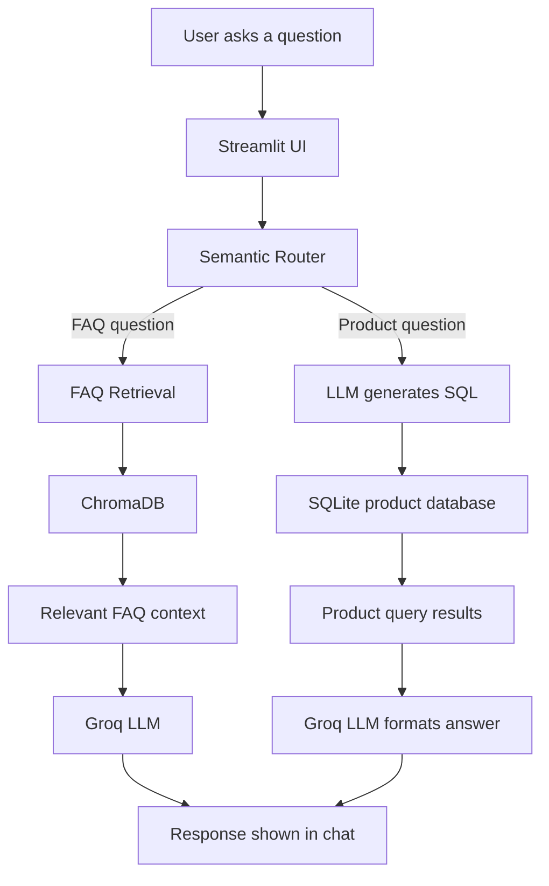

# ShopMate AI — GenAI E-commerce Chatbot

An AI-powered shopping assistant that understands natural-language questions, routes them to the right workflow, answers frequently asked questions, and searches a product database using natural-language queries.

ShopMate AI combines **semantic routing**, **FAQ retrieval with ChromaDB**, **LLM-powered SQL generation**, and a **Streamlit chat interface** to demonstrate how a GenAI assistant can support common e-commerce tasks.

> **Project status:** Portfolio / proof-of-concept project. Product availability and answers depend on the local database, FAQ data, model configuration, and connected services.

## Table of contents

- [Features](#features)
- [How it works](#how-it-works)
- [Technology stack](#technology-stack)
- [Project structure](#project-structure)
- [Getting started](#getting-started)
- [Environment variables](#environment-variables)
- [Run the application](#run-the-application)
- [Example queries](#example-queries)
- [Configuration notes](#configuration-notes)
- [Limitations and future improvements](#limitations-and-future-improvements)
- [Security notes](#security-notes)
- [Credits and licensing](#credits-and-licensing)

## Features

### 1. Semantic query routing
The app uses `semantic-router` with a Hugging Face sentence-transformer encoder to classify a user's question into one of the configured routes:

- **FAQ route** — questions about policies and general store information.
- **Product / SQL route** — questions that require searching product records.

This helps send each query to the workflow best suited to it, rather than treating every question as the same kind of request.

### 2. FAQ retrieval and answer generation
For FAQ questions, the application:

1. Loads FAQ questions and answers from a CSV file.
2. Creates embeddings using `sentence-transformers/all-MiniLM-L6-v2`.
3. Stores FAQ content in a ChromaDB collection.
4. Retrieves relevant FAQ entries for the user's question.
5. Sends the retrieved context to a Groq-hosted language model to generate a concise answer grounded in that context.

### 3. Natural-language product search
For product questions, the application:

1. Sends the user's request to a language model to generate a SQL query.
2. Executes the query against the local SQLite product database.
3. Sends the returned records to the language model to create a user-friendly response.

The product schema in the current SQL prompt includes product link, title, brand, price, discount, average rating, and total ratings.

### 4. Streamlit chat interface
The Streamlit interface provides a chat-based experience, suggested questions, route labels, loading feedback, and a custom minimal visual style.

## How it works



## Technology stack

| Technology | Purpose |
|---|---|
| Python | Application logic |
| Streamlit | Chat interface |
| `semantic-router` | Intent / route selection |
| Hugging Face Sentence Transformers | Text embeddings for semantic routing and FAQ retrieval |
| ChromaDB | FAQ vector storage and retrieval |
| Groq API | Hosted LLM inference |
| SQLite | Local product database |
| Pandas | Reading FAQ CSV data and handling query results |
| SQL | Product filtering and retrieval |

## Project structure

```text
Project2EcommerceChatbot/
└── app/
    ├── main.py              # Streamlit UI and request flow
    ├── router.py            # Semantic route definitions
    ├── FAQ.py               # FAQ ingestion, retrieval, and answer generation
    ├── sql.py               # SQL generation, SQLite query, and response formatting
    ├── db.sqlite            # Local product database
    └── resources/
        └── faq_data.csv     # FAQ question-and-answer data
```

If you also keep a `web-scraping/` directory in your repository, add it to this tree and document how it is used. It was mentioned in the earlier README, but it is not required by the app files described above.

## Getting started

### Prerequisites

- Python 3.10+ recommended
- A Groq API key
- A Groq model name supported by your account
- The project files, including the SQLite database and FAQ CSV

### 1. Clone the repository

Replace the placeholder below with your GitHub repository URL.

```bash
git clone https://github.com/<your-username>/genai-ecommerce-chatbot.git
cd genai-ecommerce-chatbot
```

### 2. Create and activate a virtual environment

**Windows PowerShell**

```powershell
python -m venv .venv
.venv\Scripts\Activate.ps1
```

**macOS / Linux**

```bash
python3 -m venv .venv
source .venv/bin/activate
```

### 3. Install dependencies

If the repository contains `app/requirements.txt`, run:

```bash
pip install -r app/requirements.txt
```

If your requirements file is stored elsewhere, use its actual path.

### 4. Configure environment variables

Create a file named `.env` in the project root used by the app's `load_dotenv()` calls. In the current code, the app expects the following variables:

```dotenv
GROQ_API_KEY=your_groq_api_key
GROQ_MODEL_NAME=your_supported_groq_model
```

Use a model name currently available to your Groq account. Do not commit `.env` to GitHub.

> **Important:** The original README used `GROQ_MODEL`, but the current Python code reads `GROQ_MODEL_NAME`. The variable name in `.env` must match the code, unless you update the code to use a different name consistently.

### 5. Start the app

From the project root:

```bash
streamlit run app/main.py
```

Streamlit will print a local URL in the terminal. Open that URL in your browser.

## Example queries

Try questions such as:

**FAQ examples**
- `What is your return policy?`
- `How long does it take to process a refund?`
- `What payment methods are accepted?`

**Product-search examples**
- `Find Nike shoes with an average rating above 4.5`
- `Show products with more than 30 percent discount`
- `Find products from a particular brand under ₹3,000`

The exact response depends on the FAQ data, products available in `db.sqlite`, and how the router classifies the query.

## Configuration notes

- **FAQ data:** The FAQ ingestion code expects a CSV with `question` and `answer` columns.
- **Product database:** The SQL workflow expects a SQLite database containing a `product` table with the columns described in `app/sql.py`.
- **Model configuration:** Set `GROQ_MODEL_NAME` to a model currently supported by your Groq account.
- **Local paths:** Keep the database and FAQ CSV in the expected project locations, or update the paths in the Python files.
- **Embeddings:** The first run may take longer while the embedding model is downloaded or initialized.

## Limitations and future improvements

This is a learning / portfolio project and can be improved in several ways:

- Add allow-list validation for generated SQL and permit only read-only `SELECT` queries.
- Add query timeouts, row limits, and safer handling of malformed SQL.
- Add explicit fallback behavior when the semantic router is uncertain.
- Add product cards with image, title, price, discount, rating, and a compact “View product” link.
- Add structured outputs instead of relying on an LLM to format database results as plain text.
- Add better logging and user-friendly error handling for API, routing, and database failures.
- Add automated tests for FAQ retrieval, routing, SQL validation, and response formatting.
- Cache the embedding model and avoid unnecessary re-ingestion of FAQ data.
- Add deployment instructions and a clear data-refresh process.

## Security notes

- **Never commit your Groq API key or `.env` file.**
- Treat LLM-generated SQL as untrusted input. Before using this outside a local demo, validate the SQL, allow only the operations required by the app, and use a read-only database connection where possible.
- Avoid showing raw internal exceptions to end users in a deployed application. Log diagnostic details privately and show a short, safe error message.
- Do not assume that model-generated answers are always correct. FAQ responses should be grounded in the retrieved source content, and product responses should reflect database results.

## Credits and licensing

The original README included a Codebasics copyright notice and a statement describing an MIT license with a restriction on commercial use. Those terms appear inconsistent: the standard MIT license permits commercial use. **Before publishing this repository, verify the original license and attribution requirements and preserve the terms that actually apply to the source code you use.** Do not label the project as MIT-licensed unless the applicable license file confirms that.

---

Built as a GenAI learning project exploring semantic routing, retrieval-augmented FAQ answering, natural-language-to-SQL product search, and a Streamlit chat interface.
